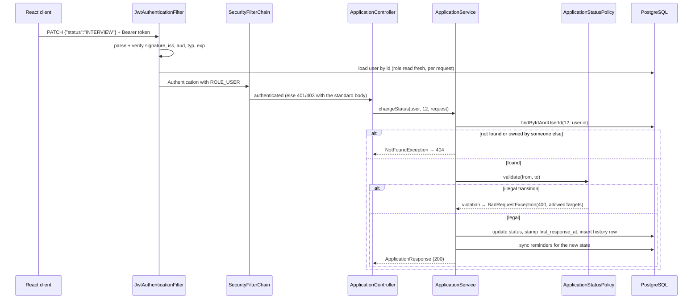
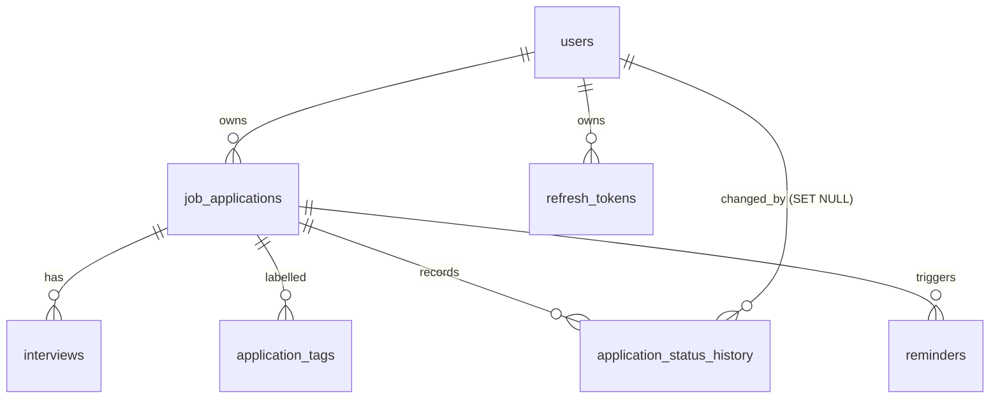

# JobTrack — Architecture

This document explains *why* the system looks the way it does. The README covers how to run it; this
covers the design: layering, the security model, the schema, the analytics rules, the reminder
pipeline, the frontend structure, the testing strategy and the trade-offs behind each decision.

---

## 1. Goals and constraints

| Goal | Consequence for the design |
| --- | --- |
| Correctness of the numbers on the dashboard | One shared denominator, rules encoded once in a service, pinned by integration tests |
| Real security, not UI-level hiding | Every query scoped server-side; role checks in two places; IDOR returns 404 |
| Runnable by a reviewer in one command | Docker Compose with three services, Flyway on boot, optional demo seed |
| No silent data loss | Append-only status history, cascade rules stated in the schema, idempotent reminders |
| Verifiable | 189 backend tests (87 unit, 102 REST integration against real PostgreSQL) + 71 frontend tests |

Non-goals (see *Known limitations* in the README): file attachments, e-mail verification flows,
multi-tenancy beyond per-user isolation, distributed scheduling locks.

---

## 2. Backend layering

```
┌──────────────────────────────────────────────────────────────────────────┐
│ web/          8 controllers + GlobalExceptionHandler + ApiErrorWriter      │  HTTP only
├──────────────────────────────────────────────────────────────────────────┤
│ security/     JwtService, JwtAuthenticationFilter, entry point,            │  who is calling
│               access-denied handler, UserDetailsServiceImpl                │
├──────────────────────────────────────────────────────────────────────────┤
│ service/      ApplicationService, InterviewService, ReminderService,       │  rules + tx
│               ReminderGenerationService, AnalyticsService, AuthService,    │
│               RefreshTokenService, AdminService, UserService, mappers …    │
├──────────────────────────────────────────────────────────────────────────┤
│ repository/   6 Spring Data repositories + specifications + projections     │  data access
├──────────────────────────────────────────────────────────────────────────┤
│ domain/       6 entities, 8 enums, ApplicationStatusPolicy                  │  invariants
└──────────────────────────────────────────────────────────────────────────┘
        dto/  request + response records and mappers (the only HTTP-visible types)
```

Rules that are enforced by convention and reviewed in every file:

1. **Controllers are thin.** They bind, delegate and pick the status code. No JPQL, no business rule,
   no `if` on domain state.
2. **Entities never leave the service layer.** Every response is a `record` in `dto/`. This is why
   `ApplicationResponse` has no `userId` and no `passwordHash` can ever be serialised by accident, and
   why adding a column cannot silently change the public contract.
3. **Services own transactions** (`@Transactional` at the service, read-only where possible).
   `open-in-view: false`, so a lazy association outside a transaction is a bug that fails loudly in
   tests instead of a hidden N+1 in production.
4. **Hibernate never writes the schema.** `ddl-auto: validate` + Flyway. The mappings are checked
   against the migrated schema at every boot.
5. **One error shape.** `GlobalExceptionHandler` is the only place that builds an `ApiError`; the
   security chain uses the same shape through `ApiErrorWriter` because a `@RestControllerAdvice` cannot
   see rejections that happen before the dispatcher servlet.

### 2.1 Request lifecycle — `PATCH /api/applications/12/status`



Two details worth calling out:

- The **role is read from the database on every request**, not trusted from the JWT claim. A promotion
  or demotion therefore takes effect immediately, and a deleted account's tokens stop working at once
  (`details.reason = user_not_found`).
- Ownership is part of the query (`findByIdAndUserId`), not a check bolted on afterwards. There is no
  code path that loads another user's row and then decides what to do with it.

---

## 3. Security model

### 3.1 Access tokens

HS256 JWTs issued by `JwtService`:

| Claim | Value |
| --- | --- |
| `sub` | user id |
| `iss` / `aud` | `jobtrack-api` (configurable, **verified** on parse) |
| `typ` | `access` — a refresh token can never be replayed as an access token |
| `jti` | random id, for log correlation |
| `email`, `name`, `role` | convenience claims for the UI; the authoritative role comes from the DB |
| `exp` / `iat` | 30 min lifetime, 30 s clock skew allowed |

The signing key must be ≥ 32 bytes (256 bits for HS256) or the app fails fast at startup. In local
development a blank secret generates an ephemeral key and logs a warning; with the `prod` profile the
app refuses to start, so a deployment cannot silently ship with a random key that invalidates every
session on restart.

### 3.2 Refresh tokens

- 256 bits of randomness, base64url-encoded, returned to the client once.
- Only the **SHA-256 hash** is stored, with `family_id`, `expires_at`, `revoked_at` and
  `replaced_by_token_hash`.
- Every use rotates: the old row is marked revoked and points at its replacement.
- **Reuse detection**: presenting an already-rotated token revokes the entire family
  (`401 token_reused`). This is what turns a stolen refresh token from a permanent backdoor into a
  detectable event.
- Family revocation must survive even though the reuse path throws: `AuthService.refresh` is therefore
  *not* `@Transactional`, and the bulk revocation queries use
  `@Modifying(flushAutomatically = true, clearAutomatically = true)` so the persistence context cannot
  resurrect the rows it just revoked. Both were real bugs found by the integration tests.

### 3.3 Authorisation

Three layers, deliberately redundant:

1. `SecurityFilterChain`: `/api/admin/**` and `/actuator/**` (beyond health/info) require `ROLE_ADMIN`;
   everything except auth, docs and health requires authentication.
2. `@PreAuthorize("hasRole('ADMIN')")` on `AdminController` **and** `AdminService`, so moving a method
   to another controller cannot expose it.
3. Ownership scoping in every repository query for user data.

Failure modes are distinct and tested: no/invalid/expired token → `401` with
`details.reason = missing_credentials | token_invalid | token_expired | user_not_found |
account_disabled`; authenticated but not allowed → `403 forbidden`; another user's resource → `404`.
The 404-for-IDOR choice is intentional: a `403` confirms the id exists, which turns the API into an
enumeration oracle.

### 3.4 Passwords, CORS, headers

- BCrypt strength 10 (~100 ms per hash) — slow enough for offline-cracking resistance, fast enough for
  interactive login.
- Password policy `^(?=.*[A-Za-z])(?=.*\d).{8,72}$` (72 is BCrypt's effective limit); login failures
  return one generic message for "unknown e-mail" and "wrong password" so the endpoint cannot enumerate
  accounts.
- Changing a password revokes every refresh token (other devices are signed out).
- CORS is an explicit allow-list of exact origins (no wildcards with credentials), configured per
  environment; the containerised frontend is same-origin through nginx and needs no CORS at all.
- CSRF is disabled because the API is stateless and cookie-free; sessions are `STATELESS`; error
  responses never include stack traces or binding errors (`server.error.include-*: never`).
- Tokens live in `localStorage` on the client. The trade-off is documented in `tokenStorage.js`:
  XSS-readable storage is mitigated by short-lived access tokens, rotating revocable refresh tokens and
  a bundle with no third-party scripts. An httpOnly-cookie refresh flow is the natural hardening step.

---

## 4. Data model



Decisions that matter:

- **`TIMESTAMPTZ` for instants, `DATE` for calendar values.** A deadline or a next-action date is a
  *day* in the user's life, not a moment; storing it as a timestamp would shift it across date lines
  when the viewer's zone differs from the owner's. Interview times are real instants, so they are
  `TIMESTAMPTZ`.
- **Enums are `VARCHAR` + `CHECK`.** Readable in `psql`, safe against typos, and portable. Hibernate
  maps them with `@Enumerated(STRING)`; `validate` catches drift at boot.
- **Cascade rules are explicit.** `users → job_applications → {interviews, reminders,
  application_status_history}` is `ON DELETE CASCADE`; `application_status_history.changed_by` is
  `ON DELETE SET NULL` because the audit trail must survive the deletion of whoever wrote it.
- **Indexes follow the queries, not the columns**: functional indexes on `lower(company)` and
  `lower(job_title)` for search; composite `(user_id, status)`, `(user_id, applied_at)`,
  `(user_id, deadline)`, `(user_id, next_action_date)`, `(user_id, created_at)`,
  `(user_id, employment_type)` for the list/filter queries, which are *always* scoped by user.
- **`ux_reminders_open_dedupe (user_id, dedupe_key) WHERE completed_at IS NULL AND dedupe_key IS
  NOT NULL`** — a partial unique index that makes reminder generation idempotent at the storage level,
  so overlapping scheduler runs or several replicas cannot duplicate a reminder. The service catches
  `DataIntegrityViolationException` and treats it as "already created".
- **Tags live in their own table** (`application_tags(application_id, tag)`, composite PK, functional
  index on `lower(tag)`) rather than a delimited string or an `@ElementCollection` against identity
  primary keys: the `tag` filter stays index-backed and a tag cannot be duplicated per application.
- **`first_response_at`** is stamped exactly once, when the employer first reacts. It is the numerator
  of the response rate and the basis of "average days to first response"; keeping it as a column means
  the aggregate is a single indexed scan instead of a history-table walk.
- **`refresh_tokens`** stores only hashes; `replaced_by_token_hash` makes the rotation chain auditable.

Migrations are Flyway-versioned (`V1__init_schema.sql`). Schema changes are additive and never edit an
applied migration.

---

## 5. Domain rules

### 5.1 Status transitions

`ApplicationStatusPolicy` is a pure function over `(from, to)` with a static transition matrix:

```
SAVED       → APPLIED, WITHDRAWN
APPLIED     → ASSESSMENT, INTERVIEW, OFFER, REJECTED, WITHDRAWN
ASSESSMENT  → APPLIED, INTERVIEW, OFFER, REJECTED, WITHDRAWN
INTERVIEW   → ASSESSMENT, OFFER, REJECTED, WITHDRAWN
OFFER       → REJECTED, WITHDRAWN
REJECTED    → APPLIED, ASSESSMENT, INTERVIEW, OFFER, WITHDRAWN
WITHDRAWN   → APPLIED, ASSESSMENT, INTERVIEW, OFFER, REJECTED
```

A violation is `400 bad_request` with `details = {from, to, allowedTargets}` so the UI can render the
legal next steps instead of guessing. Moving to the *same* status is also rejected (it would write a
meaningless history row). Creation may start at any status — a user importing an offer they already
have should not have to walk the whole pipeline. The same matrix is mirrored in
`frontend/src/utils/constants.js` for immediate UI feedback; the server remains the authority, and the
37-case unit test covers both directions of every pair.

Side effects of a transition are centralised in `ApplicationService`:

- entering `APPLIED` stamps `applied_at` if it is still null;
- entering `ASSESSMENT`, `INTERVIEW`, `OFFER` or `REJECTED` stamps `first_response_at` once;
- every change appends a history row (with `changed_by`);
- reminders are re-synced (a closed application has no deadline to prepare for).

### 5.2 Analytics

All three rates share **one denominator**: submitted applications (`status <> SAVED`).

```
responseRate     = responded / submitted          responded = first_response_at IS NOT NULL
interviewRate    = reachedInterview / submitted   reachedInterview = status ∈ {INTERVIEW, OFFER}
                                                    OR ≥ 1 interview row (counted once)
offerRate        = offers / submitted             offers = status = OFFER
```

Consequences, all asserted in `AnalyticsApiIT` against a hand-built dataset:

- Rates never exceed 1, are `0` (not `NaN`, not `null`) when the denominator is 0, and are rounded to
  4 decimals.
- An application with three interview rounds counts **once** towards `reachedInterview` — the count is
  `count(distinct case when … then application_id end)`, not a join that multiplies rows.
- Nullable aggregates (`averageDaysToFirstResponse`) are **omitted** from the JSON rather than sent as
  `null` (`@JsonInclude(NON_NULL)`), so the client distinguishes "no data" from "zero".
- Status distribution always emits all seven statuses including zeros, with shares of the total
  summing to 1.0, so the chart does not rearrange itself when a status empties.
- The **funnel is cumulative and derived from history**: stage *assessment* counts every application
  that ever had `to_status ∈ {ASSESSMENT, INTERVIEW, OFFER}`. Reading the audit trail (rather than the
  current status) means an application that jumped `APPLIED → INTERVIEW` still counts at assessment,
  and the funnel is monotonic by construction — it can never show more offers than interviews.
- Trends are gap-filled per month (an empty month is `0`, not a hole in the line) and count submitted
  applications only.

Aggregates are computed in the database (JPQL/native `sum(case when …)` and one grouped native query
for the funnel) instead of loading rows into the JVM: the response stays flat as a user's history grows.

### 5.3 Reminders

Dedupe keys make every auto reminder addressable:

```
deadline:<applicationId>:<date>     next-action:<applicationId>:<date>
follow-up:<applicationId>           interview-prep:<interviewId>
```

`ReminderGenerationService.syncApplicationReminders` reconciles the wanted set with the existing open
auto reminders: it deletes stale ones, skips ones that already exist, and inserts the rest. Because the
key contains the date, moving a deadline replaces the reminder instead of duplicating it. Reminders are
only generated while the status is *active* (`APPLIED`, `ASSESSMENT`, `INTERVIEW`) — a draft has nothing
to prepare for, and a rejected application's deadline is no longer actionable. Dates older than a year
are ignored (imported history should not create a flood of overdue items).

The nightly follow-up job is scoped per user over a bounded look-ahead window rather than scanning the
whole table, and a failure for one user cannot abort the run.

Time handling: a date-only reminder becomes due at **09:00 in the owner's IANA zone**, converted to a
UTC instant for storage and comparison. Responses carry both `dueAt` (UTC) and `dueAtLocal` (rendered in
the *requesting* user's zone) plus `overdue` and `hoursUntilDue`, so no client has to re-derive the
rule. A user in `Asia/Kolkata` sees `2026-01-12T09:00+05:30` for the same row a UTC user sees as
`2026-01-12T09:00Z` — this is asserted in the integration tests rather than left to manual QA.

---

## 6. API conventions

- **Status codes**: `201` for creation, `200` for reads and updates, `204` for deletions and
  password change, `400` for policy/validation problems, `401` unauthenticated, `403` authenticated but
  not allowed, `404` missing *or not yours*, `409` for conflicts (e.g. duplicate e-mail at the service
  level, last-admin guards).
- **Pagination envelope**: `{content, page, size, totalElements, totalPages, first, last, empty}` with
  zero-based pages and `size ≤ 100` (`@Validated` on the controller, so an absurd page size is a `400`
  rather than a full table scan).
- **Filters**: repeated keys (`status=APPLIED&status=INTERVIEW`) bind to lists — axios is configured
  with `paramsSerializer: { indexes: null }` so it does not emit `status[]=`.
- **Sorting**: named keys (`NEWEST`, `OLDEST`, `APPLIED_DATE`, `DEADLINE`, `COMPANY`, `TITLE`,
  `STATUS`, `SALARY`, `UPDATED`) with an optional `-` prefix, parsed case- and underscore-insensitively
  into a whitelist. Column names never come from user input, so there is no injection surface, and an
  unknown key is a `400` (not a silent default).
- **Date ranges** are validated: `appliedFrom` after `appliedTo` is a `400` rather than an empty page
  that looks like "no results".
- **OpenAPI**: springdoc generates the docs from the controllers and DTO records; `@Schema` examples
  make the Swagger UI usable as a client. The security scheme is declared once, so "Authorize" only
  needs the raw token.

---

## 7. Scheduled jobs

| Job | Default cron | Notes |
| --- | --- | --- |
| Reminder generation | `0 */15 * * * *` | Idempotent via dedupe keys + partial unique index |
| E-mail digests | `0 0 8 * * *` | Only if `app.reminders.email-enabled` **and** SMTP is configured; one digest per user; marks `email_sent_at` so a reminder is never sent twice |
| Housekeeping | `0 30 3 * * *` | Purges expired refresh tokens and reminders completed > 180 days ago |

Each job logs how much work it did, which is what makes a scheduler debuggable in production instead of
being a silent black box. The whole bean can be switched off (`app.reminders.enabled=false`), which the
test profile does so tests never race a cron trigger.

E-mail is behind an interface with two implementations: `SmtpEmailReminderSender` (active when
`spring.mail.host` is set) and `LoggingEmailReminderSender` (default). Mail failures are logged and
swallowed on purpose — an unreachable SMTP server must not roll back reminder generation or lose the
reminders themselves.

---

## 8. Frontend architecture

```
src/
├── api/         client.js (axios instance, interceptors, single-flight refresh), endpoints.js
├── auth/        tokenStorage.js, AuthContext.jsx, ProtectedRoute.jsx
├── components/  table, filters, forms, modal, confirm dialog, toasts, badges, pagination, charts/
├── hooks/       useDebounce
├── pages/       10 routes, all lazy-loaded
├── utils/       constants.js (statuses, transitions, enums), format.js (dates, currency, rates)
└── tests/       7 Vitest + Testing Library suites (71 tests)
```

Decisions:

- **One axios instance with two interceptors.** The request interceptor attaches the access token; the
  response interceptor catches `401 + details.reason = token_expired`, refreshes once and replays the
  original request. Concurrent failures share a single refresh promise — without that, three parallel
  widgets would each call `/auth/refresh`, and the second one would trip reuse detection and log the
  user out. That single-flight behaviour is a direct consequence of the rotation design in §3.2.
- **Session expiry is a UX event.** When refresh fails, the auth context broadcasts it, the router
  redirects to `/login` with a `from` state, and a toast explains what happened instead of the UI
  silently emptying.
- **Routes are protected declaratively** (`ProtectedRoute`, `requireAdmin`), but only as UX: hiding a
  link is not security, the API enforces everything.
- **All 10 pages are `lazy()`** behind one `Suspense`, which keeps the entry bundle at ~240 kB
  (~81 kB gzipped) and isolates recharts (~459 kB / ~122 kB gzipped) in the dashboard chunk.
- **Server-side everything for the table.** Search, filters, sorting and pagination are query
  parameters; the client never slices a large array locally, so totals stay truthful. Search input is
  debounced; filter state lives in the URL-facing query object so a reload keeps the view.
- **Forms validate locally first** (the same rules as the DTO annotations) and then surface
  `fieldErrors` from the server response, so a user sees one coherent error message per field.
- **Charts are accessible**: real `<h2>`/`<h3>` headings, `title`/`aria-label` on the chart containers,
  a data table fallback for the funnel and distributions, and `prefers-reduced-motion` respected in CSS.
- **The design system is hand-written CSS** with tokens and breakpoints; the table degrades into
  labelled cards below 760 px using `data-label` attributes rather than a second component.

---

## 9. Testing strategy

```
        frontend component/unit (71)     ← Vitest + Testing Library, jsdom, API mocked
        backend REST integration (102)   ← MockMvc + full Spring context + real PostgreSQL
        backend unit (87)                ← pure domain rules, JWT, guards, scheduler, e-mail
```

- **Unit tests** target the pieces with the most logic per line: the status-transition matrix (37
  cases, every legal and illegal pair), query-parameter parsing/sorting (22), JWT issuing and
  validation (9), the admin guards that HTTP cannot reach (7), the scheduler (7) and e-mail rendering
  (5).
- **Integration tests** are full MockMvc requests through the real filter chain, Flyway-migrated
  PostgreSQL, Jackson and validation — no service is mocked. They cover auth (register/login/refresh
  rotation/reuse/logout/disabled accounts), applications (CRUD, validation, filters, sorting,
  pagination, transitions, history, IDOR), analytics (the maths against a hand-built dataset),
  interviews and reminders (scheduling side effects, dedupe, timezones, completion, sync), and admin
  (role gate, directory counters, stats, cascade deletion, profile, password change).
- **Database**: Testcontainers PostgreSQL when a Docker daemon is available, otherwise
  `TEST_DB_URL` / `jdbc:postgresql://localhost:5432/jobtrack_test`. Tests are `@Transactional` and roll
  back, and every user gets a unique e-mail, so suites are order-independent and parallel-safe.
- **Coverage** (JaCoCo, unit + integration merged): 83.6 % of lines, 77.8 % of instructions,
  63.7 % of branches; `service` 90.5 %, `domain` 95.2 %, `security` 89.6 %, `scheduler` and `email`
  100 %. The remaining gaps are mostly `config/` (bean wiring, exercised by every integration test but
  not attributable) and defensive branches.
- **Frontend tests** mock the API layer and assert behaviour a user can observe: validation messages,
  which fields are required, that a filter chip changes the request, that the dashboard renders KPIs
  from a payload, that an expired session redirects to login. jsdom cannot measure a
  `ResponsiveContainer`, so `setup.js` stubs `ResizeObserver`, `matchMedia` and
  `getBoundingClientRect` — charts render, their geometry is not asserted.

Bugs the tests actually caught (kept here because it justifies the effort):

- bulk `@Modifying` updates leaving stale entities in the persistence context, which silently un-did
  refresh-token family revocation;
- `AuthService.refresh` rolling back its own revocation because it was `@Transactional`;
- `ReminderGenerationService` using `LocalDate.minus(Duration)` → `UnsupportedTemporalTypeException`;
- inverted `appliedFrom`/`appliedTo` returning an empty page instead of a `400`;
- a dead branch in `SortField.from` that made `APPLIED_DATE` unreachable;
- a stale `queryParams` memo in the applications table (filters one interaction behind);
- arrays passed into a single `<select>` in the filter bar;
- form validators throwing on partially filled forms.

---

## 10. Deployment and operations

- **Containers**: multi-stage builds. The API image is `eclipse-temurin:21-jre-alpine`, non-root
  (uid 1001), `MaxRAMPercentage=75`, with a curl healthcheck against `/actuator/health`. The web image
  is `nginx:1.27-alpine` serving the built SPA and proxying `/api`, `/actuator`, `/v3/api-docs` and
  `/swagger-ui` to the API — one origin for the browser, no CORS, no cross-origin credentials.
- **Compose**: `db` (postgres:17-alpine, named volume, `pg_isready` healthcheck, port not published),
  `backend` (waits for a healthy db, Flyway migrates on boot), `frontend` (waits for a healthy API).
- **Configuration**: every environment-specific value is an env var with a documented default; secrets
  have no usable default and the `prod` profile refuses to start without `APP_JWT_SECRET`.
- **Health & observability**: `/actuator/health` (with liveness/readiness probes enabled) is public;
  detailed health, `info` and `metrics` require `ADMIN`. Logs are structured single lines with the
  user id on every mutation, and security-relevant events (role changes, deletions, token reuse) are
  logged at `WARN`.
- **Scaling**: the API is stateless (no server sessions), so replicas only need the same
  `APP_JWT_SECRET`. Reminder generation is idempotent at the database level, so extra replicas do
  duplicate work but cannot duplicate data; a ShedLock-style leader election would remove the wasted
  work.
- **CI** (`.github/workflows/ci.yml`): backend `mvn verify` (unit + integration via Testcontainers on
  the runner's Docker daemon, coverage uploaded as an artifact), frontend `npm ci` → lint → test →
  build, then a build-only check of both images.

---

## 11. Decisions and trade-offs

| Decision | Why | Rejected alternative |
| --- | --- | --- |
| Records for every DTO | Immutable, no getters to forget, `@JsonInclude` on a record is the whole serialisation contract | Exposing entities (leaks `userId`, `passwordHash`, lazy-loading errors) |
| 404 for another user's resource | Prevents id enumeration | 403 (confirms existence) |
| Refresh-token rotation + family revocation | Stolen tokens become detectable and short-lived | Long-lived static refresh tokens |
| Role read from DB per request | Role changes and deletions apply immediately | Trusting the `role` claim for up to 30 min |
| Flyway + `ddl-auto: validate` | Schema is versioned, reviewable and reproducible; mapping drift fails at boot | `ddl-auto: update` (silent, irreversible drift) |
| `TIMESTAMPTZ` + `DATE` split | Deadlines do not move across date lines | Everything as timestamps |
| Cumulative funnel from history | Monotonic, survives skipped stages | Counting current statuses (funnel can invert) |
| One denominator for all rates | Numbers stay comparable; nothing double counts | Per-metric denominators |
| Partial unique index for dedupe | Idempotency guaranteed by the database, not by application timing | Check-then-insert (racy across replicas) |
| Aggregates in SQL | Flat response time as data grows | Loading rows and computing in Java |
| Vanilla CSS with tokens | No build-time dependency, full control of the responsive table→card behaviour | A component library (heavier bundle, less control) |
| Lazy routes + recharts isolated | Entry bundle stays small for the login/landing path | Eager imports everywhere |
| Testcontainers with a JDBC fallback | Real PostgreSQL semantics in tests, still runnable without Docker | H2 (the DDL is PostgreSQL-specific) |
| `localStorage` tokens | Simplest same-origin SPA auth, no cookie plumbing | httpOnly cookies (better XSS posture, needs CSRF handling) |

---

## 12. What I would do next

1. Move the refresh token into an httpOnly, `SameSite=Strict` cookie and add CSRF protection for it.
2. Add rate limiting (bucket4j + Redis) on `/api/auth/*` and lockout-with-backoff on repeated failures.
3. ShedLock for the scheduler so only one replica generates reminders.
4. E-mail verification and password reset flows (the profile already treats e-mail as immutable).
5. Export to CSV/JSON and an iCalendar feed for interviews.
6. Playwright end-to-end tests across the auth → create → interview → analytics journey.
7. Structured JSON logging plus an OpenTelemetry trace per request.
